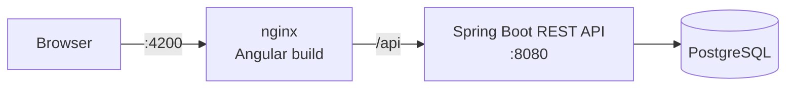

# Library Management System

[](https://github.com/muhammad-khaled-tech/library-management-system/actions/workflows/ci.yml)

A full-stack app for running a small library: manage authors, books and members, lend books and take them back. The backend is a Spring Boot REST API on PostgreSQL. The frontend is an Angular app built with Angular Material.

Built with AI-assisted development (Claude Code).

## Live demo

- App: https://library-management-system-umber-pi.vercel.app
- API docs (Swagger UI): https://library-management-api-95gp.onrender.com/swagger-ui.html

The API runs on a free instance that sleeps when idle, so the first request after a quiet period can take about a minute.

## Lending rules

- A member can borrow a book only while a copy is available.
- A member can hold at most **3** active loans.
- The due date is the borrow date + **14 days**.
- Returning a book puts the copy back and charges a late fee of **5.00 per overdue day**.
- Authors with books, and books or members with loan history, cannot be deleted.

The numbers live in `application.properties` (`library.loan.*`) and are validated at startup.

## Tech stack

| Layer | Technologies |
|---|---|
| Backend | Java 17, Spring Boot 4, Spring Web MVC, Spring Data JPA / Hibernate, Bean Validation, Flyway, springdoc OpenAPI, SLF4J, Maven (wrapper) |
| Database | PostgreSQL 17 |
| Frontend | Angular 21 (standalone components, signals, reactive forms, routing, HttpClient), Angular Material, RxJS |
| Testing | JUnit (Jupiter 6), Mockito, AssertJ, MockMvc, `@DataJpaTest`, Testcontainers, Vitest |
| Delivery | Docker, Docker Compose, nginx, GitHub Actions |

## Architecture



The backend is organized by feature (`author`, `book`, `member`, `loan`). Inside each feature the layers are the usual controller → service → repository:

- **Controllers** take and return DTOs (Java records) and validate input with Bean Validation. Entities never leave the service layer.
- **Services** own transactions and use cases.
- **Entities** hold the business rules: `Book.checkOut()` refuses when no copy is left, `Loan.borrow(...)` sets the due date, and `loan.markReturned(...)` computes the fee. These rules are unit-tested without Spring.
- **`GlobalExceptionHandler`** (`@RestControllerAdvice`) turns errors into RFC 9457 problem details.

```
library-management-system/
├── backend/                             Spring Boot API
│   ├── src/main/java/com/mkhaled/library/
│   │   ├── author/ book/ member/ loan/     one package per feature
│   │   └── common/                         errors, config, paging helper
│   └── src/main/resources/db/migration/    Flyway SQL migrations
├── frontend/                            Angular app (+ nginx.conf for Docker)
├── docker-compose.yml                   postgres + backend + frontend
└── .github/workflows/ci.yml             build, tests and image builds
```

### Design notes

- **Flyway owns the schema.** Hibernate runs with `ddl-auto=validate`, so the app refuses to start if an entity and a table disagree. The database also enforces the rules with constraints (copies never negative, unique ISBN and email).
- **Concurrency.** `@Version` on `Book` stops two requests from taking the last copy. Borrowing locks the member row (`SELECT ... FOR UPDATE`), so two parallel requests cannot pass the 3-loan check together. Conflicts return `409`.
- **No N+1 queries.** List queries fetch the author, book and member with `@EntityGraph`.
- **Stable paging.** Every sort gets `id` as a final tiebreaker, so rows with equal values (same title, same day) never repeat or vanish between pages.
- **Dates.** Services read "today" from an injected `Clock` in the library's time zone (`library.time-zone`), not the server's. Tests pin the date.
- **Derived status.** A loan's status (`ACTIVE`, `OVERDUE`, `RETURNED`) is computed from its dates, not stored.

## Run it

### With Docker (everything)

```bash
docker compose up --build
```

| What | URL |
|---|---|
| App | http://localhost:4200 |
| REST API | http://localhost:8080/api |
| Swagger UI | http://localhost:8080/swagger-ui.html |

### For development

Start only the database, then run the backend and the Angular dev server. The dev server proxies `/api` to `localhost:8080`.

```bash
docker compose up -d postgres
```

```bash
cd backend && ./mvnw spring-boot:run
```

```bash
cd frontend && npm ci && npx ng serve
```

### Configuration

| Variable | Default |
|---|---|
| `DB_URL` | `jdbc:postgresql://localhost:5432/library` |
| `DB_USERNAME` / `DB_PASSWORD` | `library` / `library` |
| `LIBRARY_TIMEZONE` | `Africa/Cairo` |
| `PORT` | `8080` |

### Deployment

The live demo runs on free tiers:

| Part | Host |
|---|---|
| Angular app | Vercel. `frontend/vercel.json` serves the build and forwards `/api` to the backend. |
| REST API | Render, built from `backend/Dockerfile`. The service settings are also in `render.yaml` as a Render Blueprint. |
| PostgreSQL | Neon |

## API

All list endpoints take `page`, `size` (max 100) and `sort` (for example `sort=title,desc`) and return `{ "content": [...], "page": { ... } }`.

| Method | Path | Description |
|---|---|---|
| GET | `/api/authors?name=` | Search authors by name |
| POST | `/api/authors` | Create an author |
| GET / PUT / DELETE | `/api/authors/{id}` | Read, update or delete one author |
| GET | `/api/books?q=` | Search by title, author name or ISBN |
| POST | `/api/books` | Add a book (ISBN-13 is validated) |
| GET / PUT / DELETE | `/api/books/{id}` | Read, update or delete one book |
| GET | `/api/members?q=` | Search by name or email |
| POST | `/api/members` | Register a member |
| GET / PUT / DELETE | `/api/members/{id}` | Read, update or delete one member |
| GET | `/api/loans?memberId=&bookId=&status=` | Filter loans; `status` is `ACTIVE`, `OVERDUE` or `RETURNED` |
| GET | `/api/loans/{id}` | One loan |
| POST | `/api/loans` | Borrow: `{ "bookId": 1, "memberId": 1 }` |
| POST | `/api/loans/{id}/return` | Return a loan and get the late fee |

Errors use one shape:

```json
{ "status": 409, "title": "Conflict", "detail": "Member 1 already has 3 active loans (limit is 3)" }
```

`400` adds an `errors` map with a message per field; `404` means not found; `409` means a rule or a concurrent change blocked the request.

## Tests

```bash
cd backend && ./mvnw verify
```

```bash
cd frontend && npx ng test --watch=false
```

The backend tests need Docker running, because Testcontainers starts a real PostgreSQL.

- **Domain unit tests:** due dates, fees across month boundaries, copy counting, loan status.
- **Service unit tests (Mockito):** every rule and error path, with a fixed `Clock`.
- **Controller tests (`@WebMvcTest`):** status codes, validation and problem-detail bodies.
- **Repository tests (`@DataJpaTest` + Testcontainers):** search queries, filters, constraints, and that lists load related data in one query.
- **End-to-end tests (`@SpringBootTest` + MockMvc + Testcontainers):** the whole lending flow over HTTP, including the late fee after moving the clock forward.
- **Frontend (Vitest):** API services, forms and validators, and list pages.

CI runs the backend tests, the frontend tests and build, and builds both Docker images on every push and pull request.
